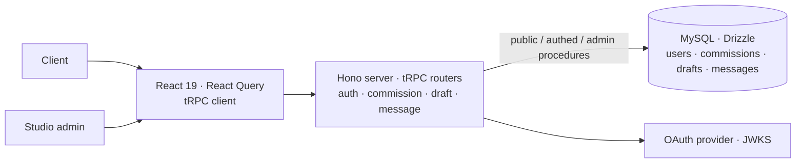

<div align="center">



<p>
  <a href="https://editorial-commission-desk.vercel.app"></a>
  
  
  
</p>

<p><em>An illustrator's portfolio with a commission portal behind it: clients send a proper brief,<br>
follow it through every stage and talk to the studio in one place.</em></p>

</div>


## The idea

Commission work usually starts in an email that is missing the budget, the deadline or who owns the rights. Editorial Commission Desk asks for all of it up front. The public side shows selected work (editorial illustration, geometric portraiture, identity systems) and the three-step process; behind a sign-in, a brief becomes a commission with a status everyone can see and a message thread attached.

> **One type from the database to the button.** The Drizzle schema, the tRPC routers on Hono and the React client share the same types through `contracts/`, so a status the server does not know cannot be sent from the page.


## Features

| | |
|---|---|
| **Portfolio** | Selected work and a three-step process: submit a brief, refine through sketch rounds and colour studies, receive the final files. |
| **Brief form** | Project type, deliverables, deadline, budget, usage rights, visual references and a description, validated with zod. |
| **Drafts** | Save a brief as a draft, come back to it, or delete it. |
| **Seven stages** | Submitted → in review → approved → in progress → delivered → completed, or cancelled. |
| **Client dashboard** | Your commissions with their stage, your drafts and the message thread. |
| **Studio controls** | Admin-only procedures move a commission between stages and reply as the studio. |
| **Messages** | A chat widget where each message is marked as client or studio. |
| **Sign-in and roles** | OAuth sign-in with signed session cookies (`jose`); user and admin roles, with the owner promoted to admin. |


## How it fits together



| Router | Procedures |
|---|---|
| `commission` | `list`, `byId`, `create`, `updateStatus` (admin) |
| `draft` | `list`, `byId`, `create`, `update`, `delete` |
| `message` | `list`, `byCommission`, `create`, `studioReply` (admin) |
| `auth` | `me`, `logout` |


## Türkçe özet

**Editorial Commission Desk**, bir editoryal illüstratör için portfolyo ve sipariş portalı. Ziyaretçiler seçili işleri ve üç adımlı süreci görüyor; müşteriler proje türü, teslimatlar, tarih, bütçe ve kullanım haklarıyla brif gönderiyor, taslak kaydedebiliyor ve siparişin yedi aşamasını panelden takip ediyor. Stüdyo, yönetici yetkisiyle aşamayı ilerletiyor ve aynı ekrandaki mesajlaşmadan cevap veriyor. Hono üzerinde tRPC ve Drizzle ile MySQL kullanılıyor; tipler veritabanından arayüze kadar ortak.


## Development

```sh
npm install
cp .env.example .env
npm run db:push        # create the tables
npm run dev            # Vite with the Hono dev server
npm run check          # tsc -b
npm run build && npm run build:server
npm start
```

`.env` takes `DATABASE_URL`, the OAuth settings (`KIMI_CLIENT_ID`, `KIMI_CLIENT_SECRET`, `KIMI_AUTH_URL`, `KIMI_OPEN_URL`, `VITE_KIMI_AUTH_URL`), `APP_ID` / `APP_SECRET` for sessions and `OWNER_UNION_ID` for the studio account. The `AWS_*` entries are reserved for file uploads, which are not wired yet.

```
api/          Hono server, tRPC routers, middleware (public / authed / admin), OAuth and sessions
db/           Drizzle schema, relations, migrations, seed
contracts/    shared types, constants and errors
src/          React pages (Home, Login, Dashboard), chat widget, tRPC provider
```

Deployed on Vercel with `api/[[...all]].ts` as the server entry; a Dockerfile is included for self-hosting.

<div align="center">
<br>
<a href="https://github.com/kutluhangil"></a>
<sub>All rights reserved · the client, project and artwork in the banner are invented.</sub>
</div>
