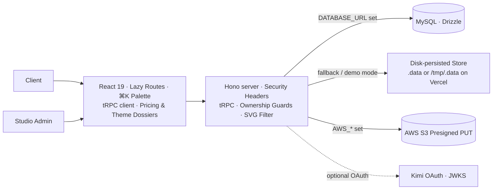

<div align="center">


<p>
  <a href="https://editorial-commission-desk.vercel.app"></a>
  
  
  
</p>

<p><em>An illustrator's portfolio with a full studio operating desk behind it: browse dedicated case study dossiers,<br>
explore artist rosters &amp; archival editions, simulate usage rights &amp; kill fees, proof visuals live, and ship press-ready work.</em></p>

</div>


## The idea

Commission work usually starts in an email that is missing the budget, the deadline, mechanical specs, or who owns the rights. **Editorial Commission Desk** is an open-source, white-label creative studio portfolio and client commission portal template customizable from a single configuration file ([src/config/studio.config.ts](src/config/studio.config.ts)). The public experience pairs a live 4-movement visual theme engine (*Mondrian*, *Bauhaus*, *Swiss*, *Noir*) — each with custom generated studio plates, bespoke visual artwork, and CSS custom property tokens — with a `⌘K` Studio Command Palette, an 8-piece portfolio opening full dossiers (`/work/:slug`), and six dedicated studio pages: **Artists Roster** (`/artists`), **Archival Print Editions** (`/editions`), **Licensing & Kill-Fee Matrix** (`/licensing`), **Press Mechanicals** (`/specs`), **Colophon & Design System** (`/colophon`), and a shareable **Client Review Room** (`/review/:code`). Behind a one-click workspace sign-in (with live **Client** / **Studio Admin** role switching), commissions move across **List**, **Kanban Board**, and **Capacity Calendar** views with coordinate `[x%, y%]` pin proofing, an escrow-locked deliverables vault, revision round caps, theme-aware PDF invoices & dossiers, and an immutable audit trail.

> **Zero-friction setup + hardened dual storage.** Works out of the box with no external credentials via signed HS256 sessions and a disk-backed local store (`.data/store.json`, automatically using `/tmp/.data` on Vercel), enforces per-user ownership checks and SVG sanitization, and upgrades seamlessly to MySQL (`DATABASE_URL`), Kimi OAuth (`VITE_KIMI_AUTH_URL`), and AWS S3 presigned uploads (`S3_BUCKET`).


## Features (Full Studio Platform)

| | |
|---|---|
| **1. White-Label Config + 4 Art-Movement Themes** | Customize studio identity, portfolio dossiers, artist roster, print editions, kill fees, and prepress specs in `src/config/studio.config.ts`, and toggle live between **De Stijl Mondrian**, **Bauhaus Archive**, **Swiss Alpine Grid**, and **Noir Atelier** with distinct hero/studio artwork. |
| **2. Dedicated Studio Pages + `⌘K` Command Bar** | Explore deep Case Study Dossiers (`/work/:slug`), Principals Roster (`/artists`), Numbered Print Editions (`/editions`), Usage Licensing & Kill-Fee Simulator (`/licensing`), Press Mechanical Specs (`/specs`), Colophon & Live CSS Token Inspector (`/colophon`), and Plate 404 recovery — all searchable via `⌘K` / `Ctrl+K`. |
| **3. Shareable Client Review Room (`/review/:code`)** | Open dedicated review rooms such as `/review/ECD-2026-0001` or `?share=ECD-2026-0001` so art directors can inspect deliverables, coordinate pins, milestone settlement, and export dossiers without friction. |
| **4. Interactive Visual Proofing & Pin Annotations** | Click anywhere on `v1 Wireframe` / `v2 Spot Color` / `v3 Press Master` proof plates to drop numbered `[x%, y%]` feedback pins, compare versions, and toggle pin resolution status. |
| **5. Versioned Deliverables Vault + Escrow Lock** | Publish `v1` → `v2` → `v3` production assets with automatic escrow lock protection on final press masters until all milestone invoices are settled. |
| **6. Revision Round Guard (Scope-Creep Shield)** | Tracks `Used / Included` revision rounds per commission; exceeding the contract cap automatically appends a surcharge invoice and notifies both threads. |
| **7. 40% / 40% / 20% Billing & Theme-Aware Dossiers** | Splits fees into commencement deposit, sketch approval, and final release milestones with printable commercial tax invoices and self-contained HTML/PDF dossiers styled dynamically after the active studio theme. |
| **8. Instant-Book Studio Packages & AOI 4D Calculator** | Fixed-scope package cards (`Op-Ed Spot`, `Cover System`, `Book Jacket`, `Data Spread`) and an AOI/Guild 4D licensing calculator (`Territory × Duration × Circulation × Exclusivity`) that pre-fill the 3-step brief modal. |
| **9. Code-Split Vite Bundles & Asset Optimization** | Every route loads on demand via `React.lazy` + `Suspense`, vendor dependencies split into dedicated cacheable chunks, hero imagery sets `fetchPriority="high"`, and gallery plates use `loading="lazy"`. |
| **10. Ownership IDOR, SVG & Sandbox Hardening** | Enforces user/admin ownership checks across commissions, pins, drafts, and messages; rejects MIME-mismatched data URLs or embedded SVG scripts/handlers; sets HTTP security headers with a 6 MB body cap; and supports `ENABLE_DEMO_SANDBOX=false` in production. |


## How it fits together



| Router | Procedures |
|---|---|
| `auth` | `me`, `demoLogin` (guarded by `ENABLE_DEMO_SANDBOX`), `logout`, `switchRole` |
| `commission` | `list`, `listAll` (admin), `byId` (owner/admin), `create`, `updateStatus` (admin), `cancel` (owner), `approveDelivery` (owner/admin), `workspaceById` (public share room), `workspacesOverview`, `addPin`, `togglePinResolved` (owner/admin), `uploadDeliverable` (admin), `requestRevision`, `payMilestone`, `resetDemo` (sandbox) |
| `draft` | `list`, `byId` (owner/admin), `create`, `update` (owner/admin), `delete` (owner/admin) |
| `message` | `list`, `listAll` (admin), `byCommission` (owner/admin), `create`, `studioReply` (admin) |
| `upload` | `status`, `presignOrInline` (strict MIME + SVG script validation) |


## Türkçe özet

**Editorial Commission Desk**, illüstratörler ve yaratıcı tasarım stüdyoları için tek yapılandırma dosyasından (`src/config/studio.config.ts`) markalanabilen tam kapsamlı açık kaynak portfolyo ve müşteri komisyon portalı şablonudur. Her biri kendine özgü stüdyo/banner görsellerine ve CSS renk değişkenlerine sahip canlı 4 sanat akımı teması (*Mondrian*, *Bauhaus*, *Swiss*, *Noir*) ile `⌘K` Komut Çubuğu içerir. Ana sayfanın yanında 7 yeni stüdyo sayfası sunar: detaylı vaka dosyaları (`/work/:slug`), sanatçı kadrosu (`/artists`), numaralı baskı edisyonları (`/editions`), kullanım hakları & kill-fee simülatörü (`/licensing`), baskı öncesi teknik spesifikasyonlar (`/specs`), canlı token inceleyici kolofon (`/colophon`) ve paylaşılabilir müşteri prova odası (`/review/:code`). Arka planda rota bazlı React kod bölme (lazy-loading), sahip/yetki (IDOR) kontrolleri, SVG XSS doğrulaması, Vercel salt-okunur dosya sistemi için `/tmp/.data` uyumluluğu ve tema uyumlu PDF fatura/dosya çıktılarıyla uçtan uca üretime hazır çalışır.


## Development

```sh
npm install
npm run dev            # Vite + Hono dev server (works immediately with .data/store.json)
npm run check          # tsc -b
npm run lint           # eslint .
npm test               # vitest run (workflow + IDOR + SVG sanitization suites)
npm run build && npm run build:server
npm start
```

Optional `.env` variables enable managed infrastructure while keeping zero-config defaults otherwise:
- **MySQL (`DATABASE_URL`):** Enables Drizzle/MySQL persistence (`npm run db:push && npx tsx db/seed.ts`); otherwise falls back to `.data/store.json` (or `/tmp/.data/store.json` on Vercel).
- **S3 (`AWS_REGION`, `AWS_ACCESS_KEY_ID`, `AWS_SECRET_ACCESS_KEY`, `S3_BUCKET`):** Enables direct presigned S3 PUT uploads for visual references; otherwise validates and attaches safe inline assets.
- **Demo Sandbox (`ENABLE_DEMO_SANDBOX`):** Set to `false` to disable unauthenticated `demoLogin` and `resetDemo` endpoints in locked-down production environments.
- **Kimi OAuth (`KIMI_CLIENT_ID`, `KIMI_CLIENT_SECRET`, `KIMI_AUTH_URL`, `KIMI_OPEN_URL`, `VITE_KIMI_AUTH_URL`, `VITE_APP_ID`, `OWNER_UNION_ID`):** Unlocks external Kimi OAuth alongside the built-in Client / Studio Admin demo switcher.

```
api/          Hono server, security headers, tRPC routers, ownership guards, dual MySQL + memory store
db/           Drizzle schema, relations, migrations, seed script
contracts/    shared types, constants and errors
src/          11 lazy-loaded studio pages, StudioCommandPalette (⌘K), StudioPageShell, pricing & dossier utilities
```

Deployed on Vercel with `api/[[...all]].ts` as the server entry and SPA filesystem fallback routing; a Dockerfile is included for self-hosting.

<div align="center">
<br>
<a href="https://github.com/kutluhangil"></a>
<sub>All rights reserved · the client, project and artwork in the banner are invented.</sub>
</div>
