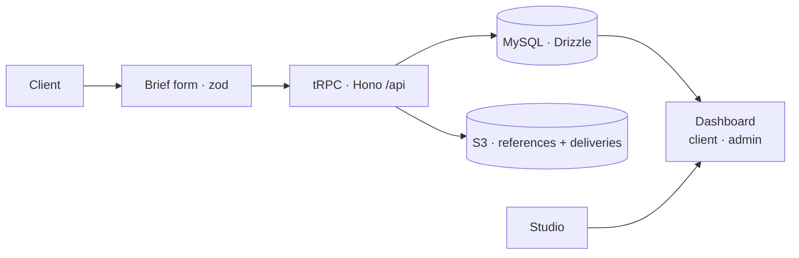

<div align="center">


<p>
  <a href="https://editorial-commission-desk.vercel.app"></a>
  
  
  
</p>

<p><em>A portfolio for an editorial illustrator with a built-in commission portal:<br>
clients submit a brief, follow its progress and receive the final files with rights documentation.</em></p>

</div>


## What it is

The public side shows selected work (editorial illustration, geometric portraiture, identity systems) and explains the process in three steps: submit a brief, refine through sketch rounds and colour studies, receive the final files. Behind a sign-in, clients and the studio share one dashboard for every commission.

| | |
|---|---|
| **Brief form** | Project type, deliverables, deadline, budget, usage rights, visual references and a description. |
| **Status tracking** | Submitted → in review → approved → in progress → delivered → completed (or cancelled). |
| **Dashboard** | Clients see their commissions; admins see and move every brief. |
| **File handling** | References and deliveries stored on S3 with presigned URLs. |
| **Auth** | Cookie sessions with signed tokens and user / admin roles. |
| **Type-safe API** | tRPC routers on a Hono server, shared contracts and Drizzle schema. |




## Türkçe özet

**Editorial Commission Desk**, bir editoryal illüstratör için hazırlanmış portfolyo ve sipariş portalı. Ziyaretçiler seçili işleri ve üç adımlı çalışma sürecini görüyor; müşteriler proje türü, teslimatlar, tarih, bütçe ve kullanım haklarıyla brif gönderip siparişin durumunu panelden takip ediyor. Hono üzerinde tRPC, Drizzle ile MySQL ve dosyalar için S3 kullanılıyor.


## Development

```sh
npm install
cp .env.example .env         # database URL, S3 bucket, session secret
npm run dev                  # Vite frontend
npm run build && npm run build:server
npm start
```

```
src/pages/      home (portfolio), login, dashboard
api/            Hono server, tRPC routers (auth, commission), middleware
db/             Drizzle schema, relations, migrations, seed
contracts/      shared types, constants and errors
```

<div align="center">
<br>
<a href="https://github.com/kutluhangil"></a>
<sub>Good work starts with a good brief.</sub>
</div>
